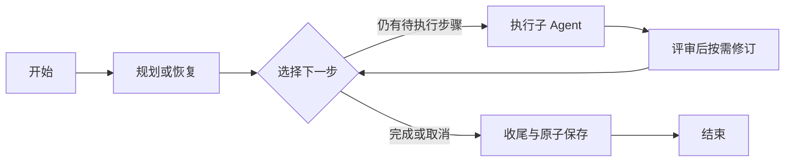

# 2026-09-29 框架强化

本次将内容库与统计页的服务端数据状态交给 TanStack Vue Query，将新建 Studio 流水线的执行推进交给 LangGraph。FastAPI、Vue、SQLAlchemy、RQ 及现有工作区权限、发布幂等、SSE 契约继续使用。

## LangGraph 试点

锁定 `langgraph==1.2.12`，与既有 `langchain-core==1.6.3` 配套。`requirements.lock` 已用仓库约定的跨平台 Python 3.11 方式生成；除新依赖外，`websockets` 按 LangGraph SDK 的兼容范围从 17.1 调整到 16.1.1。项目最低 Python 声明与实际锁及 CI 统一为 3.11。

这是一组实际的图节点和条件边，不是把整个旧循环包进单个节点。图与兼容模式调用同一批业务方法。图有明确步数上限，未启用框架自动重试，防止与现有任务重试叠加。

持久进度只有一个来源：PostgreSQL 中的 `agent_runs.plan_json` 与 `run_steps`。每次恢复从已提交的步骤重新构建图内存状态；LangGraph 自带 saver 未接入。既有租约校验、工作区过滤、checkpoint 先于步骤完成事件、最终内容与终态事件原子提交继续生效。

配置 `PIPELINE_ENGINE=langgraph_v1` 默认影响新任务，也可设为 `legacy`。每个新 run 在存储的请求中固定 `_pipeline_engine`：

| 运行记录 | 执行 / 恢复行为 |
| --- | --- |
| 标记为 `langgraph_v1` | 使用图执行，即使后来将环境配置改为 `legacy` |
| 标记为 `legacy` | 使用兼容循环 |
| 历史记录没有标记 | 固定使用兼容循环 |
| 不认识的版本标记 | 明确拒绝，避免静默更换恢复逻辑 |

该配置是停止对新任务启用图的开关，不是将已经启动的新图任务交给不支持它的旧代码。当前尚未添加人工审核暂停界面、LangGraph 原生检查点或 Temporal。

## TanStack Vue Query

锁定 `@tanstack/vue-query@5.104.0`，并通过统一 QueryClient 管理内容库及统计查询。内容列表按筛选条件分页，统计按日期和平台缓存；成功写入触发相关查询失效，页面按需刷新。

- Query key 包含内存中的随机工作区会话标识，不包含 bearer token，也不将业务缓存持久化到浏览器磁盘。
- 登录身份变化先禁用工作区读取，取消并清空旧缓存，换新标识后再启用。跨标签账号变化及 BFCache 恢复同样清理。
- Axios 消费 AbortSignal；即使底层未遵守取消，查询结果还要检查会话身份，防止旧账号结果回填。
- 读取最多额外重试两次，取消与不可恢复的客户端错误不重试；写入不自动重试。
- SSE 对话和流水线流、输入表单等交互状态继续由原来的专用逻辑管理。

复查补齐了三个交错场景：成功写入先取消旧查询再重新读取，避免首次请求尚未完成时把写入前的数据标为新鲜；旧会话的 401 与流式消息不影响新账号；断开后的旧 SSE 连接不能继续更新新连接状态。普通任务轮询也使用每次尝试的标识，隔离“停止后立即重启”的迟到响应。

## 升级

1. 使用 Python 3.11+，执行 `python -m pip install -r requirements.lock`。
2. 在 `frontend` 目录执行 `npm ci` 和 `npm run build`。
3. 停止或排空旧 API、worker、reaper，按既有流程执行 `alembic upgrade head` 后统一启动新版本。

本次框架接入本身没有新增迁移；包含上一轮租约修复的版本仍须升级到 `0011_pipeline_run_leases`。本地验证使用独立数据库及假模型，没有调用真实发布平台、没有对业务数据库迁移或部署。

## 验证结果

- 后端全量：802 passed、20 skipped；其中 19 项独立配置检查另行执行并全部通过，另 1 项 Gunicorn 原生配置检查依赖 POSIX，在 Windows 跳过。
- 全量收集后补充的图并发投递和失租恢复用例，与图/租约测试一起复验：32 passed。此数与全量重叠，不相加。
- 前端：27 套、343 项通过；`vue-tsc` 与 Vite 生产构建通过。
- Ruff 检查/格式（148 文件）、mypy（90 源文件）、`pip check` 和 `git diff --check` 均通过。

浏览器使用独立 PostgreSQL 和假模型完成真实页面、API、图执行、事件流与保存链路：4 步完成、最终内容只保存一次；数据库确认 `langgraph_v1`、1 条完成事件及成功后清空 checkpoint。统计总数从 65 更新为 66；内容库依次加载 30、60、66 条，并能检索最旧稿件；修改读数后统计浏览量从 6,000 更新为 7,000，互动量保持 450，互动率变为 6.4%；切换到第二个空账号后，列表和统计均为 0。

本轮没有验证真实模型生成质量、生产规模压测、真实 Redis/RQ 进程故障或外部平台发布。临时浏览器、API、Vite 和测试 PostgreSQL 已停止。完整结构化记录见 [框架验证记录](evidence/2026-09-29-framework-validation.json)。

## 参考

- [LangGraph Graph API](https://docs.langchain.com/oss/python/langgraph/graph-api)
- [TanStack Vue Query](https://tanstack.com/query/latest/docs/framework/vue/overview)
