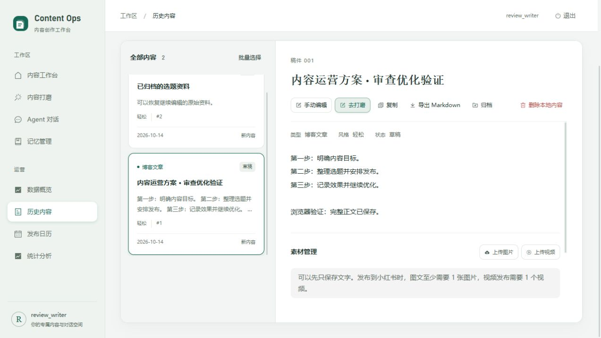

# 2026-10-14 项目审查与优化

本轮从现有工作流、接口与数据一致性、工作区隔离、任务与发布、媒体、记忆、前端交互、依赖和部署配置进行审查，并直接修复能在当前项目内验证的问题。代码与自动测试是主要依据；新增的用户操作另外使用真实浏览器和独立 PostgreSQL 验证。

## 已完成的优化

| 优先级 | 原有不足 | 本轮结果 |
| --- | --- | --- |
| P1 | 平台接受的定时发布被保存为 `planned` 日历事件，页面允许编辑或删除，让用户误以为可以修改平台排期 | 新记录使用 `scheduled`；旧记录若匹配同一内容、平台、日期的已接受排期，也按平台计划展示并禁止本地修改。真实发布服务到日历接口的回归覆盖此流程 |
| P1 | 后台生成、Agent、打磨、标题、SEO 五类任务绕过已有模型调用限流 | 五个创建入口接入同一按用户计数的限流；超限返回 429 和 Retry-After，入队前拒绝；查询/取消任务不受该限流影响 |
| P1 | 前端锁文件被 npm audit 报告 3 项 high 告警 | Vue 及配套包由 3.5.33 更新到 3.5.44，source-map-js 更新至 1.2.2，并同步兼容的传递依赖；不升级框架主版本 |
| P2 | Python 锁文件中的 multidict 6.8.0 存在已知引用泄漏告警 | 精确更新至修复版本 6.9.1，保持其他 Python 依赖不变；重新审计并执行完整后端回归 |
| P2 | 内容只能通过 AI 打磨修改，没有直接修正文案的入口 | 内容库增加手动编辑标题、正文和标签；保存后刷新详情、列表及相关统计缓存，保留素材、日历、发布记录和既有状态 |
| P2 | 直接编辑容易被另一个页面的旧稿覆盖 | 编辑请求必须携带读取时的 `updated_at`；数据库行锁内验证，过期返回 409；页面保留输入，确认后才加载最新版本 |
| P2 | 归档只有入口，没有恢复操作 | 已归档内容增加“恢复为草稿”，明确恢复到本地草稿状态；不会声称恢复归档前状态或撤销平台发布 |
| P2 | 内容只能复制正文，缺少文件导出 | 增加 Markdown 下载，包含完整正文、标题和标签，处理文件名非法字符；使用详情而非列表截断预览 |
| P2 | 记忆保存返回时覆盖保存期间的新输入；加载失败仍可保存空默认内容 | 保存绑定提交快照，后续输入继续保留；首次读取成功后才允许编辑；防重复提交，错误原因持久显示，可重试 |
| P2 | 重新加载/离开记忆页可能丢失未保存输入；前端 emoji 字数和后端不同 | 增加未保存提示、重新加载确认、路由离开和浏览器关闭提醒；按 Unicode code point 统计，与 Python 一致 |
| P2 | 记忆搜索迟到结果覆盖新查询，清空后结果又出现，错误被显示成空结果 | 输入变化、工作区变化和卸载使旧请求失效；失败与无结果分开显示，并支持重试 |
| P2 | 图片上传只有数量限制，没有单个文件大小限制 | 增加可配置的 20 MiB 默认上限，逐块检查并清理本次不完整文件；视频继续使用已有独立上限 |
| P2 | `days=N` 日历查询使用闭区间却加 N 天，多返回一天；普通发布入口可携带过去的定时时间 | 日期窗口包含今天共 N 天；两个发布入口均拒绝过去的定时时间 |
| P2 | 手机宽度下编辑表单较长，底部按钮容易移出视口 | 弹窗限制高度，正文区域独立滚动，取消和保存按钮固定在可视弹窗底部 |

历史内容中的发布标题覆盖字段现在默认保持为空，使用当前稿件标题作为占位提示，避免手动编辑后仍携带旧标题作为发布覆盖值。

## 接口与配置

- 新增 `PUT /api/content/{id}`：完整提交 `title`、`content`、`tags`、`expected_updated_at`。缺失并发令牌或多余字段返回 422，旧令牌返回 409，非本人内容或不存在返回 404。`expected_updated_at` 必须原样使用 GET 返回值，旧数据为 null 时也必须显式传 null。
- 标题最多 500 个字符、正文非空且最多 200,000 个字符、标签最多 30 个且每个最多 50 个字符。标签去除两端空白并按原顺序去重，允许清空标签和标题。
- 新增 `POST /api/content/{id}/restore`：只允许 `archived → draft`。不修改媒体或平台记录，不恢复之前的发布状态。
- 手动编辑只更新本地稿件。已经提交的平台内容及定时发布快照维持原提交内容，编辑框明确显示这一规则。
- `MEDIA_MAX_IMAGE_SIZE_MB=20` 控制单图上限；配置必须为正数，Compose 与环境模板已接入。超过上限返回 400，与现有视频上传错误契约一致。HTTP multipart 接收和代理请求体限制是另一层边界，这不是完整的磁盘配额系统。
- `LLM_RATE_LIMIT_PER_MINUTE` 已接入 Compose，保持 `0` 为禁用的兼容默认值。需要限流的部署必须显式设置正整数；这是请求次数限制，不是金额/Token 月度预算。
- `GET /api/calendar/events?days=60` 现在表示今天及之后 59 天。显式 `start_date/end_date` 仍为闭区间。
- **没有新增数据库迁移，也没有修改业务数据库。** 部署时按更新后的锁文件安装依赖（前端 `npm ci`，后端 `pip install -r requirements.lock`），重新构建前端并重启服务；数据库仍应遵循仓库已有迁移要求。

旧排期保护采用保守匹配：同一内容、平台、日期存在状态为 `scheduled` 的平台记录时，该日匹配的旧本地计划也会被保护。现有 schema 没有日历到 publication 的直接关联，未来应补上关联以精确区分同一天的独立计划。本轮不批量改写历史数据。

## 全面审查中仍需继续建设的能力

| 优先级 | 剩余缺口及依据 | 建议验收标准 |
| --- | --- | --- |
| P1 | 统一任务中心和刷新恢复：`Studio.vue` 的 `runId` 是组件内状态，挂载只恢复选题参数；`jobs.py` 只有按 ID 查询/取消，没有当前用户的任务列表 | 刷新、关闭重开、任务超时后可从列表找到运行、查看阶段并从后端 checkpoint 继续；列表和恢复按账号隔离 |
| P1 | 平台最终状态闭环：现有发布服务记录平台接受结果，没有轮询/回调同步“定时已实际发布”、线上撤销和修改 | 将 publication 与 calendar 直接关联；平台状态同步具备幂等、失败重试及可见的同步时间；真实平台沙盒验证 |
| P2 | 内容版本比较和回滚：已有 parent_id/version，但手动编辑更新当前记录，没有每次修改的全文快照 | 建立不可变修订历史，支持来源关系、差异预览、明确确认回滚，并覆盖并发与权限 |
| P2 | 长期记忆的跨页面并发编辑：文件锁保证写入完整，但整个文件覆盖保存没有版本比较 | GET 返回版本/ETag，PUT 校验版本；另一个页面或 Agent 更新后，旧编辑器不能覆盖新文件 |
| P2 | 开发模式重启可靠性：background 延迟重试使用进程内 Timer | 对真实 Redis/RQ 的延迟重试、队列丢失和 worker 崩溃做故障注入；开发模式明确标注恢复边界 |
| P2 | 大规模检索、统计和资源配额尚无实测容量目标 | 用目标数据规模测量 P95 延迟、SQL 查询计划、上传磁盘占用；根据结果增加索引、分页、清理策略和每用户配额 |
| P2 | 账号自助维护：当前 auth 路由提供注册/登录/退出，没有改密、找回密码及会话管理页面 | 补充有身份核验的改密/找回流程、会话撤销，并验证旧凭据失效 |

以上为后续产品/架构事项，不能仅凭当前单元测试或代码静态检查宣称已经解决。当前账号隔离、Agent 写工具授权、租约回收、流水线 checkpoint、SSE、媒体路径及迁移契约沿用现有实现并通过本轮后端回归。

## 验证记录

- 后端 PostgreSQL 全量：**840 passed、20 skipped、0 failed**，126.36 秒。使用新建本机独立测试集群及一次性数据库，无外部模型或平台调用；此结果包含 multidict 更新后的重新验证。
- 20 个跳过项中，19 个生产配置检查已按项目要求独立执行并全部通过；另 1 个 Gunicorn 配置检查依赖 POSIX，Windows 未执行。
- 前端最终：**30 套、359 项测试通过**，`vue-tsc` 和 Vite 生产构建通过，包括安全依赖更新后的重新安装与构建。
- Python Ruff lint、163 个文件格式检查、90 个源文件 Mypy 及 `git diff --check` 通过。
- 前端全依赖 `npm audit --audit-level=high`：**0 vulnerabilities**。修复前生产依赖审计为 3 个 high。
- Python `pip-audit -r requirements.lock --no-deps --disable-pip`：当前 Windows 环境匹配的 **108 个依赖、0 个已知漏洞**；`pip check` 通过。Linux 专属条件依赖未在此次 Windows 审计中执行。
- 新增数据库回归包含同一稿件的两个并发编辑只有一个成功、旧编辑不能覆盖归档、更改/恢复的真实双账号隔离、平台排期新旧记录保护、日历日期边界、后台任务限流及超限图片清理。
- 浏览器验证：真实账号登录、内容编辑保存、归档恢复、下载 Markdown 并读取文件确认完整文本与标签、记忆离开提醒、保存后刷新仍保留、375×812 弹窗没有横向溢出且操作按钮可见。

机器可读结果见 [验证记录](evidence/2026-10-14-review-validation.json)。示例截图只包含隔离测试账号及测试内容。

[375×812 编辑弹窗验证截图](screenshots/review-editor-mobile-20261014.jpg)

依赖告警依据：[Vue 公告](https://github.com/advisories/GHSA-g2v6-rqmx-r4w6)、[source-map-js 公告](https://github.com/advisories/GHSA-68fv-2mgg-jv7q)、[multidict 公告](https://github.com/advisories/GHSA-54p9-h82j-f925)。Vue 公告涉及 SSR；本项目是客户端 SPA，本轮没有证明其生产界面可被该 SSR 路径利用，依赖更新同时消除审计门禁告警。

本轮未启动完整 Docker/TLS 栈，Docker daemon 在执行时不可用；未执行真实 Redis/RQ 故障注入、外部 LLM 和小红书平台联调或大规模压力测试。浏览器验证使用独立 API、Vue 服务、PostgreSQL 和记忆目录，平台登录状态使用测试替身。没有部署、推送或提交 Git commit。
